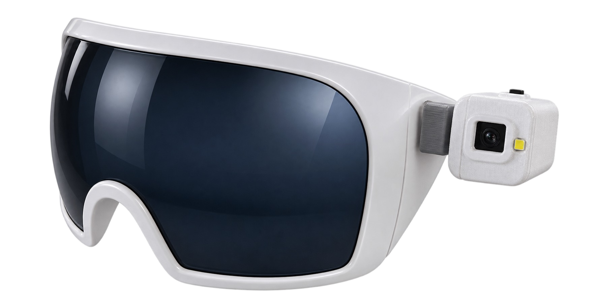
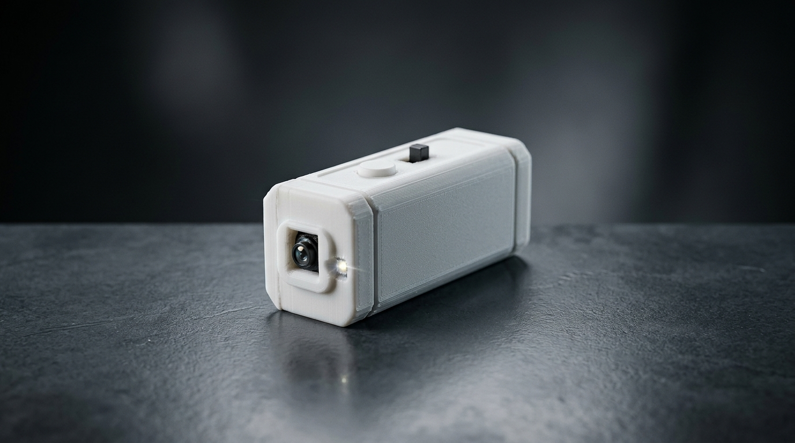
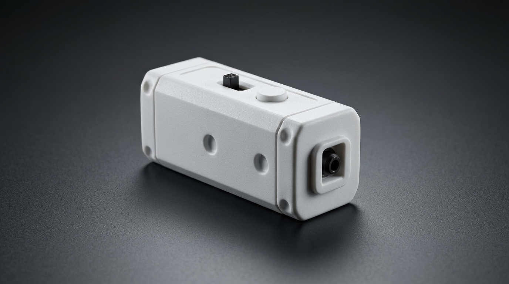
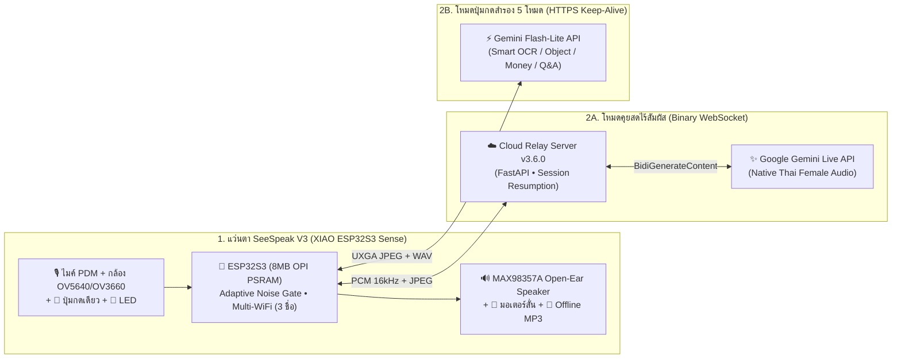
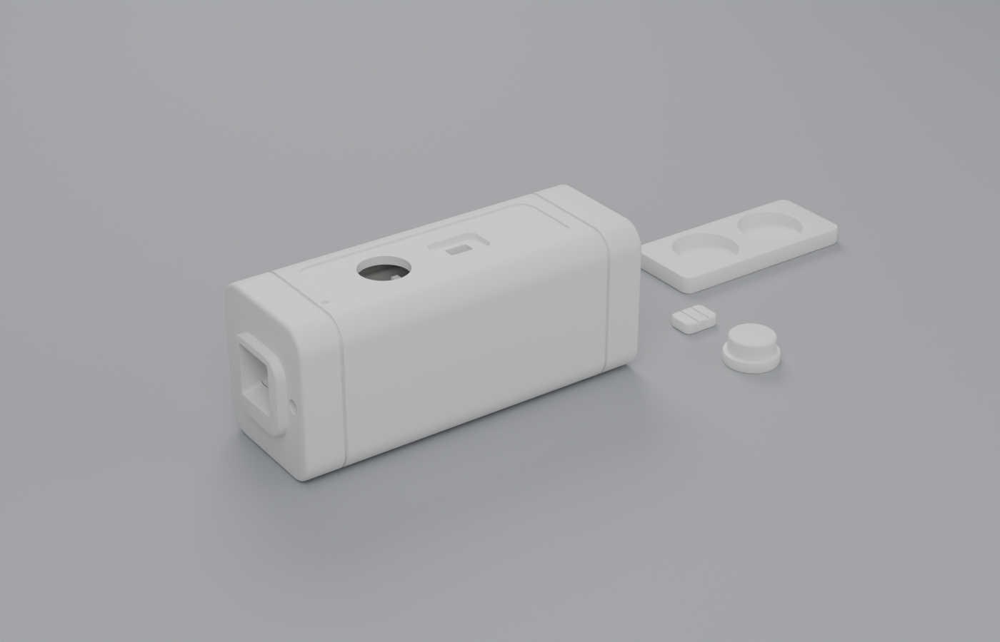
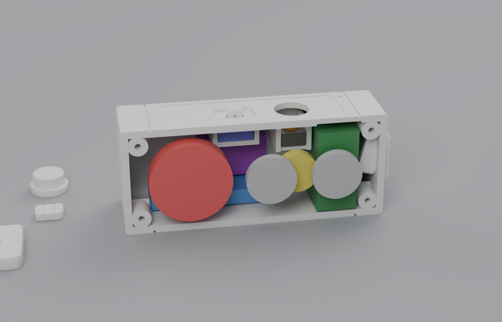

<div align="center">



# 👓 SeeSpeak V3
### อุปกรณ์เสริมแว่นตาอัจฉริยะสำหรับผู้บกพร่องทางสายตา (รุ่นพัฒนาต่อยอดระดับภาค 2569)
**"มองเห็นผ่านเสียง เคียงข้างทุกก้าว"**

<p>
  
  
  
  
  
  
</p>

<p>
  <a href="#-ภาพชิ้นงานต้นแบบจริง">📸 ภาพชิ้นงานจริง</a> •
  <a href="#-จุดเด่นของนวัตกรรม-seespeak-v3">✨ จุดเด่น V3</a> •
  <a href="#-โหมดการทำงาน-hands-free--ปุ่มกดเดียว">🎯 โหมดการทำงาน</a> •
  <a href="#-สถาปัตยกรรมระบบ-hybrid-architecture-2b">🧠 สถาปัตยกรรม V3</a> •
  <a href="#-ฮาร์ดแวร์และผังการต่อวงจร">🔌 ฮาร์ดแวร์</a> •
  <a href="#-การออกแบบเคส-3-มิติ-3d-print">🧊 เคส 3D Print</a> •
  <a href="#-การติดตั้งและตั้งค่า-api-key">🚀 การติดตั้ง</a> •
  <a href="#-โครงสร้างไฟล์ในโปรเจกต์">📂 โครงสร้างไฟล์</a>
</p>

</div>

---

## 💡 แนวคิดและที่มาของโครงการ

**SeeSpeak V3** คือนวัตกรรม **อุปกรณ์เสริมแว่นตาอัจฉริยะแบบประกบติดด้วยแม่เหล็ก (Magnetic Smart Glasses Attachment)** ที่ออกแบบมาเพื่อช่วยเหลือ **ผู้บกพร่องทางสายตา** ในการดำเนินชีวิตประจำวันได้อย่างอิสระ ปลอดภัย และเป็นธรรมชาติมากยิ่งขึ้น โดยพัฒนาต่อยอดจากรุ่นระดับจังหวัดสู่ **ระดับภาค ประจำปีการศึกษา 2569 (ศูนย์การค้าเซียร์รังสิต)**

ตัวอุปกรณ์สามารถ **ประกบติดเข้ากับขาแว่นตาเดิมของผู้ใช้งานได้ทุกทรงด้วยแม่เหล็กนีโอไดเมียม (Magnetic Quick-Mount)** ภายใน 1 วินาที ในรุ่น **V3** ได้ยกระดับสู่สถาปัตยกรรม **Hybrid Architecture 2B** ที่รองรับทั้ง **โหมดคุยสดไร้สัมผัส (Hands-Free Live Voice AI)** พูดโต้ตอบกับผู้ช่วยเสียงภาษาไทยได้ทันทีภายใน **~0.9–1.5 วินาที** โดยไม่ต้องกดปุ่ม และยังคงระบบ **ปุ่มกดเดียวครบ 5 โหมดสำรอง** พร้อม **มอเตอร์สั่นที่ขมับ (Haptic Feedback)** และ **ลำโพงเปิดหู (Open-Ear Audio)** ที่ไม่ปิดกั้นเสียงรถและสิ่งแวดล้อมรอบข้าง

---

## 📸 ภาพชิ้นงานต้นแบบจริง

<table>
  <tr>
    <td align="center" width="50%">
      
      <br />
      <sub><b>มุมด้านหน้าตัวเครื่อง:</b> รองรับกล้อง OV5640 (5MP) / OV3660 (3MP), ไฟแฟลช SMD LED อัตโนมัติ, ปุ่มกดสั่งงาน และสวิตช์เปิด-ปิด</sub>
    </td>
    <td align="center" width="50%">
      
      <br />
      <sub><b>มุมด้านข้างระบบยึดแม่เหล็ก:</b> ฝังแม่เหล็กนีโอไดเมียม 2 จุด สำหรับประกบติดขาแว่นตาเดิมได้แน่นหนาและถอดชาร์จสะดวก</sub>
    </td>
  </tr>
</table>

---

## ✨ จุดเด่นของนวัตกรรม (SeeSpeak V3)

| จุดเด่น | รายละเอียดการทำงาน |
| :--- | :--- |
| 🗣️ **คุยสดไร้สัมผัส (Hands-Free Live Voice AI)** | เชื่อมต่อผ่าน Cloud Relay (`v3.6.0`) เข้าสู่ **Google Gemini Live API** ตอบกลับเป็นเสียงผู้หญิงไทยธรรมชาติภายใน ~0.9–1.5 วินาที จำบทสนทนาต่อเนื่อง พูดแทรกให้หยุดได้ (`Barge-in`) และต่อท่อใหม่อัตโนมัติแบบไม่หลุด (`Session Resumption`) |
| 🔇 **กรองเสียงรบกวนในฮอลล์แข่งอัตโนมัติ** | มีระบบ `Adaptive Noise Floor` + `HPF 250Hz` + `Echo Gate` ปรับเกณฑ์ไมโครโฟนตามเสียงรบกวนรอบข้างอัตโนมัติ |
| 🔘 **Hybrid Fallback ปุ่มกดเดียว 5 โหมด** | แม้ไม่มี Cloud Relay ยังใช้งานได้ครบทั้ง 5 โหมดผ่านการยิงตรง **Gemini Flash-Lite** พร้อมมอเตอร์สั่นแจ้งจังหวะที่ขมับ |
| 📡 **Multi-WiFi Failover (จำได้ 3 เครือข่าย)** | บันทึกชื่อ Wi-Fi / ฮอตสปอตได้สูงสุด 3 เครือข่าย สลับไปเครือข่ายสำรองอัตโนมัติทันทีเมื่อสัญญาณหลุด |
| 📷 **รองรับกล้อง OV5640 (5MP) & OV3660 (3MP)** | ตรวจจับเซนเซอร์กล้องอัตโนมัติตอนบูต ถ่ายภาพความละเอียดสูงคมชัดพร้อมไฟแฟลช SMD LED อัตโนมัติในที่แสงน้อย |
| 🔋 **แบตเตอรี่ 600 mAh + วัดแบตจริง 3 ชั้น** | อัปเกรดรองรับแบต LiPo 600 mAh พร้อมวงจรแบ่งแรงดัน `200kΩ + 200kΩ` เข้าขา `D3 (GPIO4)` อ่าน % แบตจริง 0–100% แม่นยำและมีเสียงเตือนออฟไลน์ |
| 🔊 **ลำโพงเปิดหู + เสียงเตือนออฟไลน์ในบอร์ด** | ขับเสียงผ่านแอมป์ `MAX98357A I2S` โดยไม่ปิดกั้นเสียงรอบข้าง พร้อมไฟล์เสียงไทย MP3 ใน Flash พูดเตือนได้แม้ไม่มีเน็ต |
| 📱 **หน้าเว็บตั้งค่าในตัว (`SeeSpeak-Setup`)** | ตั้งค่า Wi-Fi 3 ชื่อ (มีปุ่มลูกตาดูรหัสผ่าน), Gemini API Key, Relay URL, ความดังลำโพง และ Noise Gate ผ่านมือถือ รองรับ **TalkBack / VoiceOver** |

---

## 🎯 โหมดการทำงาน (Hands-Free + ปุ่มกดเดียว)

> [!TIP]
> **หยุดพูดได้ทันทีทุกเมื่อ:** ขณะที่เครื่องกำลังพูดยาว ๆ ผู้ใช้งานสามารถพูดคำว่า **"หยุด / พอ"** หรือ **กดปุ่ม 1 ครั้ง** เพื่อหยุดเสียงพูดทันทีและพร้อมรับคำสั่งใหม่

| รูปแบบการสั่งงาน | การสั่นแจ้งเตือนที่ขมับ | โหมดการทำงาน | รายละเอียดความสามารถ |
| :--- | :--- | :--- | :--- |
| **พูดถามได้ทันที (ไม่ต้องกดปุ่ม)** | — *(ทำงานอัตโนมัติเมื่อเปิดเครื่อง)* | 🗣️ **โหมดคุยสดไร้สัมผัส (Hands-Free Live)** | สนทนาโต้ตอบสดพร้อมส่งภาพจากกล้องให้ Gemini Live ตอบคำถามเรื่องสี สิ่งของ ป้าย ข้อความ หรือธนบัตรแบบต่อเนื่อง |
| **กดปุ่ม 1 ครั้ง** | สั่นสั้น 1 ครั้ง + แฟลช | 📖 **โหมดที่ 1: อ่านข้อความ (Smart OCR)** | อ่านข้อความไทย/อังกฤษความละเอียดสูง (`UXGA 1600×1200`) จากป้าย ฉลากยา ราคาสินค้า เมนู หรือเอกสาร *(หรือกดเพื่อหยุดเสียงพูด)* |
| **กดปุ่ม 2 ครั้งติดกัน** | สั่นสั้น 2 ครั้ง + แฟลช | 🧭 **โหมดที่ 2: อธิบายวัตถุและทิศทาง** | อธิบายสิ่งของ บุคคล และสภาพแวดล้อมตรงหน้า พร้อมระบุตำแหน่ง (`ซ้าย / กลาง / ขวา`) และระยะห่างโดยประมาณ |
| **กดปุ่ม 3 ครั้งติดกัน** | สั่นสั้น 3 ครั้ง + แฟลช | 💵 **โหมดที่ 3: นับธนบัตรและเหรียญไทย** | ตรวจนับธนบัตรไทย (`20, 50, 100, 500, 1000 บาท`) และเหรียญ โดยพูด **สรุปยอดเงินรวมทั้งหมดขึ้นเป็นคำแรกเสมอ** |
| **กดปุ่มค้างไว้ขณะพูด** | สั่น 1 ครั้งเริ่มฟัง + แฟลชเมื่อปล่อย | 🎙️ **โหมดที่ 4: ถาม-ตอบด้วยเสียง (Push-to-Talk)** | บันทึกเสียงคำถามจากไมค์ PDM ส่งพร้อมภาพตรงหน้าให้ Gemini ตอบพร้อมจำบริบท 3 รอบล่าสุด |
| **เปิดสวิตช์เครื่อง** | สั่นต้อนรับ 1 ครั้ง → สั่น 2 ครั้งเมื่อพร้อม | 👋 **โหมดที่ 5: โหมดต้อนรับ (Welcome Mode)** | แจ้ง % แบตเตอรี่ เชื่อมต่อ Multi-WiFi อัตโนมัติ และพูดแนะนำวิธีใช้งานครบทุกโหมด |
| **กดปุ่ม 4 ครั้งติดกัน** | สั่นสั้น 2 ครั้ง + สั่นยาว 1 ครั้ง | ⚙️ **โหมดตั้งค่า (`SeeSpeak-Setup`)** | ปล่อย Wi-Fi ชื่อ `SeeSpeak-Setup` เพื่อตั้งค่า Wi-Fi 3 ชื่อ, API Key, Relay URL และระดับเสียงผ่านมือถือ |
| **กดปุ่ม 5 ครั้งติดกัน** | สั่นยืนยันสถานะ | 🔇 **เปิด/พักโหมดคุยสดชั่วคราว** | พักโหมดคุยสดไร้สัมผัสเมื่ออยู่ในพื้นที่เสียงดังมาก (ยังใช้ปุ่มกด 1–3 ครั้งและกดค้างได้ตามปกติ) |

---

## 🧠 สถาปัตยกรรมระบบ (Hybrid Architecture 2B)



---

## 🔌 ฮาร์ดแวร์และผังการต่อวงจร

<div align="center">
  
  <br />
  <sub><b>ภาพการพัฒนาวงจรต้นแบบ:</b> บอร์ด XIAO ESP32S3 Sense, โมดูลกล้อง OV5640/OV3660, แอมป์เสียง MAX98357A I2S และชุดปุ่มควบคุม</sub>
</div>

<br />

### รายการอุปกรณ์หลักและผังขาเชื่อมต่อ (Pinout)

| ขาบนบอร์ด `XIAO ESP32S3` | GPIO | อุปกรณ์ที่เชื่อมต่อ | หน้าที่การทำงาน |
| :---: | :---: | :--- | :--- |
| **`D0`** | `GPIO 1` | ปุ่มกด `Tactile Switch 6×6 มม.` (อีกขาต่อ `GND`) | รับคำสั่งปุ่มกด 1–5 คลิก / กดค้าง / หยุดเสียงพูด / ปลุก Deep Sleep |
| **`D1`** | `GPIO 2` | ผ่าน `R 220Ω` → ทรานซิสเตอร์ `S8050` → `SMD LED` (`R 10–15Ω`) | ขับไฟแฟลช LED ด้านหน้ากล้องอัตโนมัติ |
| **`D2`** | `GPIO 3` | ผ่าน `R 220Ω` → ทรานซิสเตอร์ `S8050` → มอเตอร์สั่น `10×3 มม.` (`+ 1N4148`) | ขับมอเตอร์สั่นแจ้งเตือนที่ขมับ (Haptic Feedback) |
| **`D3`** | `GPIO 4` | วงจรแบ่งแรงดัน `R 200kΩ + 200kΩ` จาก `BAT+` ลง `GND` | อ่านแรงดันแบตจริง 0–100% (หากยังไม่ต่อ ระบบจะสลับใช้ Software Fuel Gauge อัตโนมัติ) |
| **`D8` / `D9` / `D10`** | `GPIO 7 / 8 / 9` | `MAX98357A I2S` (`BCLK` / `LRC` / `DIN`) → ลำโพง `8Ω 1W 20 มม.` | ขับเสียงพูดภาษาไทยและเสียงออฟไลน์บนพอร์ต `I2S_NUM_1` *(ห้ามเสียบ MicroSD Card ในช่องบนบอร์ดเพราะใช้ขาร่วมกัน)* |
| **Onboard Sense** | `GPIO 41 / 42` | ไมโครโฟนดิจิทัล `PDM` (`DATA` / `CLK`) | รับเสียงพูดคุยสด Live และโหมดกดค้างถาม-ตอบ บนพอร์ต `I2S_NUM_0` |
| **Onboard Sense** | Camera FPC | โมดูลกล้อง `OV5640 (5MP)` หรือ `OV3660 (3MP)` | ตรวจจับเซนเซอร์อัตโนมัติ ถ่ายภาพคมชัดสูงสุด `UXGA (1600×1200)` |
| **`BAT+` / `BAT-`** | Power Pads | แบตเตอรี่ `LiPo 3.7V 600 mAh` คั่นด้วยสวิตช์เลื่อน `SS-12D00` | จ่ายไฟและชาร์จผ่านพอร์ต USB-C บนบอร์ด |

> 📖 ดูขั้นตอนการบัดกรีทีละเส้น รายการอะไหล่ และวิธีประกอบเครื่องแบบละเอียดได้ที่ **[`05_คู่มือประกอบและเอกสารอ้างอิง/คู่มือการต่อวงจรและประกอบเครื่อง_SeeSpeak.md`](05_คู่มือประกอบและเอกสารอ้างอิง/คู่มือการต่อวงจรและประกอบเครื่อง_SeeSpeak.md)**

---

## 🧊 การออกแบบเคส 3 มิติ (3D Print)

ออกแบบด้วย **Blender** ให้มีขนาดกะทัดรัด พิมพ์ด้วยเครื่องพิมพ์ 3 มิติได้ครบทั้ง 5 ชิ้นส่วน (ไฟล์พร้อมพิมพ์อยู่ในโฟลเดอร์ [`03_โมเดล3มิติ_และไฟล์พิมพ์_STL/blender_model/stl_print/`](03_โมเดล3มิติ_และไฟล์พิมพ์_STL/blender_model/stl_print/))

<table>
  <tr>
    <td align="center" width="50%">
      
      <br />
      <sub><b>แบบจำลอง 3 มิติ (มุมหน้า):</b> เลนส์กล้องด้านหน้า ปุ่มกดและสวิตช์เลื่อนด้านบน</sub>
    </td>
    <td align="center" width="50%">
      
      <br />
      <sub><b>แบบจำลอง 3 มิติ (มุมหลัง):</b> ช่องตะแกรงลำโพง Open-Ear และพอร์ตชาร์จ USB-C</sub>
    </td>
  </tr>
  <tr>
    <td align="center" width="50%">
      
      <br />
      <sub><b>ชิ้นส่วนสำหรับพิมพ์ 3D Print:</b> ตัวเคส ปุ่มกด หัวสวิตช์ และแผ่นยึดขาแว่นแม่เหล็ก</sub>
    </td>
    <td align="center" width="50%">
      
      <br />
      <sub><b>การจัดวางภายในเคส:</b> ออกแบบช่องลงล็อกพอดีสำหรับบอร์ด XIAO, แอมป์เสียง, แบตเตอรี่ และลำโพง</sub>
    </td>
  </tr>
</table>

---

## 🚀 การติดตั้งและตั้งค่า API Key

> [!IMPORTANT]
> เพื่อความปลอดภัยของคีย์ส่วนตัว **ไฟล์โค้ดบน GitHub นี้ได้ซ่อน Gemini API Key, รหัสผ่าน Wi-Fi และ URL เซิร์ฟเวอร์ส่วนตัวไว้ทั้งหมดแล้ว** ผู้ใช้งานสามารถนำ API Key ของตนเองจาก [Google AI Studio](https://aistudio.google.com/apikey) มากรอกผ่านหน้าเว็บ **`SeeSpeak-Setup`** บนมือถือหรือตั้งใน Environment Variables ของ Render ได้ทันที

### 1. อัปโหลดเฟิร์มแวร์ V3 ด้วย Arduino IDE 2.x
1. เปิดไฟล์เฟิร์มแวร์รุ่นล่าสุด **[`02_โค้ดและเซิร์ฟเวอร์_V3_ล่าสุด/firmware_seespeak_v3/firmware_seespeak_v3.ino`](02_โค้ดและเซิร์ฟเวอร์_V3_ล่าสุด/firmware_seespeak_v3/firmware_seespeak_v3.ino)** *(ไฟล์เสียงออฟไลน์ [`offline_voice_mp3.h`](02_โค้ดและเซิร์ฟเวอร์_V3_ล่าสุด/firmware_seespeak_v3/offline_voice_mp3.h) อยู่ในโฟลเดอร์เดียวกันแล้ว)*
2. ติดตั้งบอร์ด **`esp32` (by Espressif Systems v3.x)** และไลบรารี 3 ตัวใน Library Manager:
   - **`ArduinoJson`** *(by Benoit Blanchon)*
   - **`ESP32-audioI2S`** *(by Schreibfaul1)*
   - **`WebSockets`** *(by Markus Sattler — เวอร์ชัน 2.7.1 ขึ้นไป)*
3. ตั้งค่าเมนู **Tools** ก่อนกด **Upload (`→`)**:
   - **Board:** `XIAO_ESP32S3`
   - **PSRAM:** `OPI PSRAM` *(สำคัญมาก!)*
   - **USB CDC On Boot:** `Enabled`
   - **Partition Scheme:** `Default with spiffs (3MB APP/1.5MB SPIFFS)`

### 2. เปิดใช้งาน Cloud Relay Server (สำหรับโหมดคุยสดไร้สัมผัส)
* ดูขั้นตอนการ Deploy ฟรีบน **Render.com** (ตั้ง `Root Directory` เป็น `relay_server` และตั้งตัวแปร `GEMINI_API_KEY` ใน Environment Variables) ได้ที่ **[`relay_server/README_DEPLOY.md`](relay_server/README_DEPLOY.md)**

### 3. ตั้งค่า Wi-Fi, API Key และ Relay URL ผ่านมือถือ (`SeeSpeak-Setup`)
1. เปิดสวิตช์เครื่อง (หรือ **กดปุ่ม 4 ครั้งติดกัน**) เพื่อเข้าสู่โหมดตั้งค่า
2. เชื่อมต่อ Wi-Fi ชื่อ **`SeeSpeak-Setup`** แล้วเปิดเบราว์เซอร์ที่ `http://192.168.4.1`
3. กรอก Wi-Fi ได้สูงสุด 3 เครือข่าย, **Gemini API Key**, **Cloud Relay URL** และปรับความดังลำโพง จากนั้นกดบันทึก

---

## 📊 ผลการทดสอบประสิทธิภาพ

จากการทดสอบประสิทธิภาพชิ้นงานต้นแบบและการประเมินความพึงพอใจของผู้ใช้งานจริง (อ้างอิงจากรายงานการวิจัย ว-สอศ-3):

| ตัวชี้วัดการประเมิน | ผลลัพธ์ที่ได้ |
| :--- | :---: |
| 🎯 **ความแม่นยำในการประมวลผลเฉลี่ย** *(ทดสอบครบทั้ง 5 โหมด รวม 100 ครั้ง)* | **`93.00%`** |
| ⭐ **ระดับความพึงพอใจของผู้ทดสอบและผู้ใช้งาน** *(กลุ่มตัวอย่าง 52 คน)* | **`4.42 / 5.00`** *(S.D. = 0.36)* |
| ⚡ **ความเร็วการตอบสนองในรุ่น V3 (Hands-Free Live)** | **~0.9–1.5 วินาที** ผ่าน `Gemini Live API` + `Cloud Relay v3.6.0` |

<details>
<summary><b>📄 คลิกเพื่อดูแผ่นพับประชาสัมพันธ์ผลงาน SeeSpeak (ด้านหน้าและด้านหลัง)</b></summary>
<br />
<div align="center">
  
  <br /><br />
  
</div>
</details>

---

## 📂 โครงสร้างไฟล์ในโปรเจกต์

```text
SeeSpeak/
├── 01_เอกสารส่งแข่งระดับภาค_เซียร์รังสิต/        # 📄 ชุดเอกสารส่งประกวดระดับภาค 2569 ฉบับจริง (.docx & .pdf)
│   ├── 0_ปกหน้าเล่มสีขาว_ระดับภาค_2569.*         # ปกหน้าเล่มสีขาวพร้อมเคลือบใส
│   ├── 1_ว-สอศ-2_แบบเสนอโครงการวิจัย_ระดับภาค.*   # แบบเสนอโครงการวิจัย (13 หน้า)
│   ├── 2_ว-สอศ-3_แบบรายงานการวิจัย_ระดับภาค.*     # รายงานการวิจัยฉบับสมบูรณ์ (17 หน้า)
│   ├── 3_ภาคผนวก_ระดับภาค.*                      # ภาคผนวกครบ 6 หัวข้อ + คู่มือ 2 ภาษา ไทย-อังกฤษ (38 หน้า)
│   ├── คู่มือเตรียมแข่งระดับภาค_เซียร์รังสิต_2569.md
│   └── เช็กลิสต์ก่อนปริ้นต์ส่งกรรมการ.md
├── 02_โค้ดและเซิร์ฟเวอร์_V3_ล่าสุด/              # 💻 ซอร์สโค้ดเฟิร์มแวร์ V3 ล่าสุด (ซ่อน API Key แล้ว)
│   ├── firmware_seespeak_v3/                    # เฟิร์มแวร์ XIAO ESP32S3 + ไฟล์เสียงออฟไลน์ MP3
│   └── relay_server/                            # ลิงก์อ้างอิงไปยัง /relay_server ที่ระดับ Root
├── 03_โมเดล3มิติ_และไฟล์พิมพ์_STL/               # 🧊 โมเดล 3 มิติ Blender, ภาพเรนเดอร์ และไฟล์พิมพ์ .STL
│   ├── blender_model/
│   └── hardware_3d_case/
├── 04_รูปภาพ_โปสเตอร์_และแผ่นพับ/                # 🎨 ภาพชิ้นงานจริง โปสเตอร์ แผ่นพับ และภาพชิ้นส่วนวงจร
│   ├── element/
│   ├── รูปชิ้นงานสวยๆ/
│   └── แผ่นพับ/
├── 05_คู่มือประกอบและเอกสารอ้างอิง/              # 📖 คู่มือการต่อวงจร แนวปฏิบัติ สปด.ภาค 2569 และเอกสารอ้างอิง
├── relay_server/                                # ☁️ Cloud Relay Server v3.6.0 (คงไว้ที่ Root เพื่อ Auto-Deploy บน Render.com)
│   ├── Dockerfile
│   ├── README_DEPLOY.md
│   ├── requirements.txt
│   └── server.py
├── .gitignore
└── README.md
```

---

## 🏫 หน่วยงานและการประกวด

* **สถานศึกษา:** แผนกวิชาเทคโนโลยีคอมพิวเตอร์ วิทยาลัยเทคนิคลพบุรี
* **รายการประกวด:** การประกวดสิ่งประดิษฐ์ของคนรุ่นใหม่ ระดับภาค ภาคกลางและภาคตะวันออก กรุงเทพมหานคร ประจำปีการศึกษา 2569 — ประเภทที่ 5 ด้านนวัตกรรมและเทคโนโลยีเพื่อสุขภาพ (Health Care)
* **เอกสารฉบับสมบูรณ์:** ดูรายงานการวิจัยและเอกสารประกอบครบชุดได้ในโฟลเดอร์ [`01_เอกสารส่งแข่งระดับภาค_เซียร์รังสิต/`](01_เอกสารส่งแข่งระดับภาค_เซียร์รังสิต/)

<div align="center">
  <br />
  <sub>พัฒนาด้วยความตั้งใจเพื่อยกระดับคุณภาพชีวิตของผู้บกพร่องทางสายตา • <b>SeeSpeak V3 Smart Glasses Attachment</b></sub>
</div>
