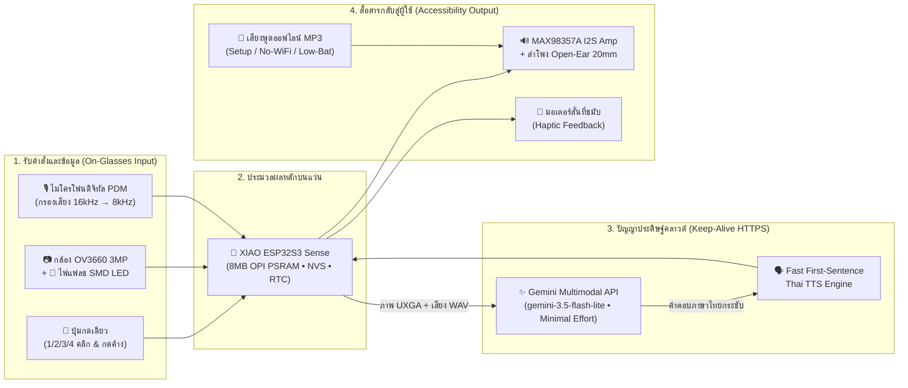
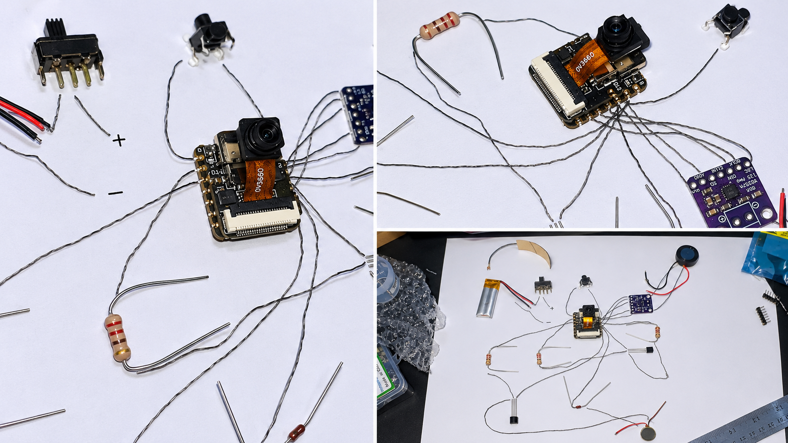
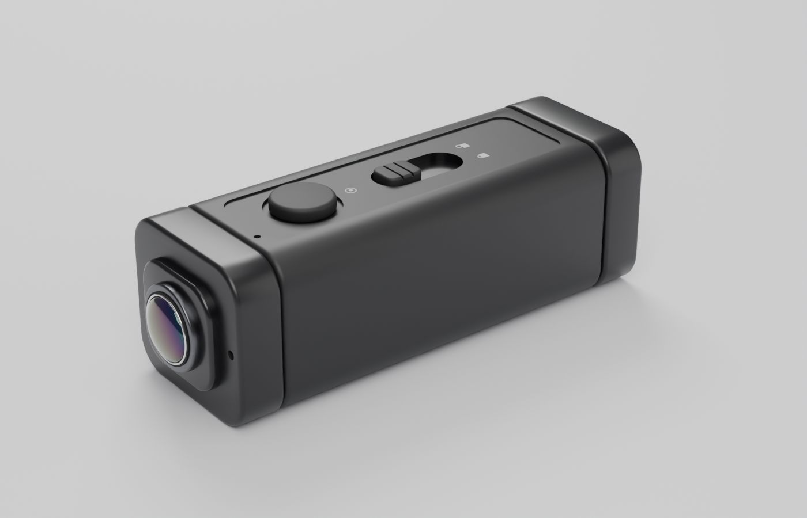
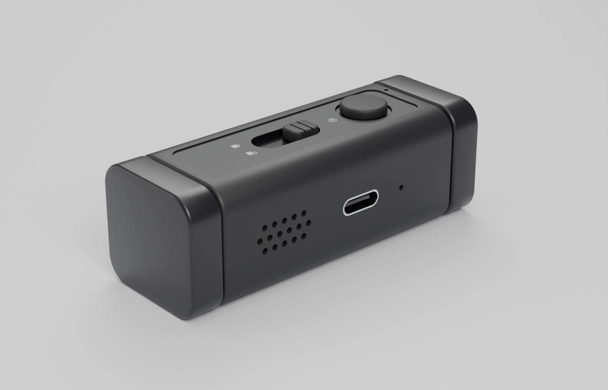
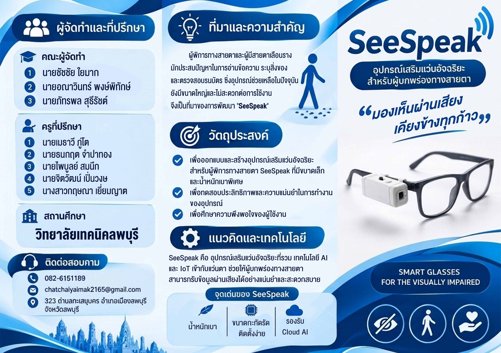
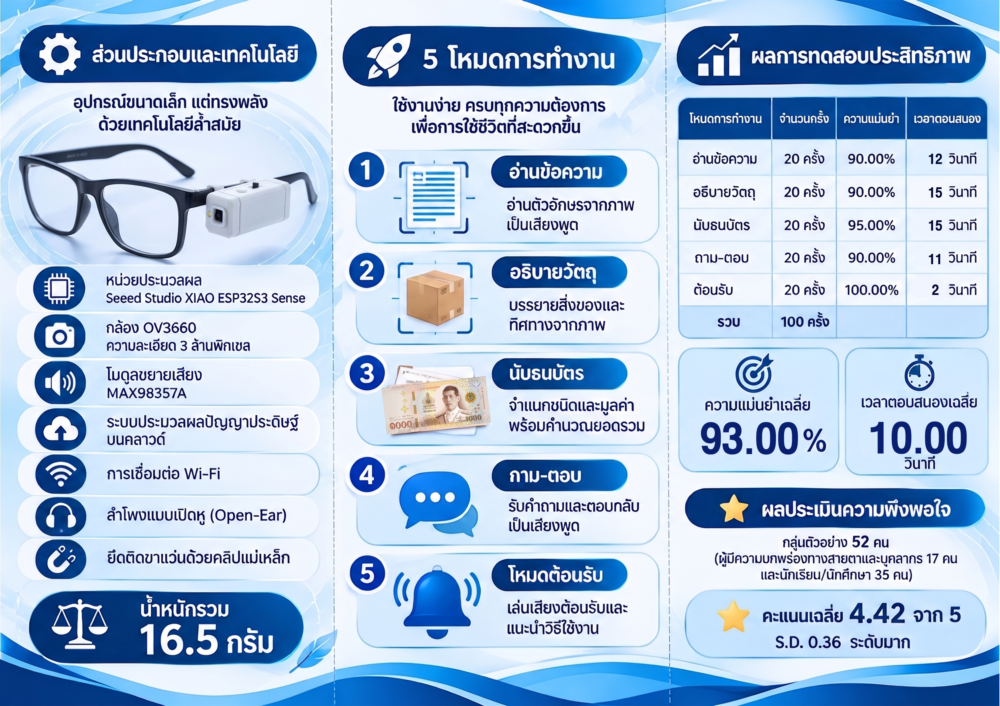

<div align="center">


# 👓 SeeSpeak
### อุปกรณ์เสริมแว่นตาอัจฉริยะสำหรับผู้บกพร่องทางสายตา
**"มองเห็นผ่านเสียง เคียงข้างทุกก้าว"**

<p>
  
  
  
  
  
  
</p>

<p>
  <a href="#-ภาพชิ้นงานต้นแบบจริง">📸 ภาพชิ้นงานจริง</a> •
  <a href="#-จุดเด่นของนวัตกรรม">✨ จุดเด่น</a> •
  <a href="#-5-โหมดการทำงานด้วยปุ่มเดียว">🎯 5 โหมดการทำงาน</a> •
  <a href="#-สถาปัตยกรรมระบบ">⚙️ สถาปัตยกรรมระบบ</a> •
  <a href="#-ฮาร์ดแวร์และผังการต่อวงจร">🔌 ฮาร์ดแวร์</a> •
  <a href="#-การออกแบบเคส-3-มิติ-3d-print">🧊 เคส 3D Print</a> •
  <a href="#-การติดตั้งและใช้งาน">🚀 การติดตั้ง</a> •
  <a href="#-ผลการทดสอบประสิทธิภาพ">📊 ผลการทดสอบ</a>
</p>

</div>

---

## 💡 แนวคิดและที่มาของโครงการ

**SeeSpeak** คือนวัตกรรม **อุปกรณ์เสริมแว่นตาอัจฉริยะ (Magnetic Smart Glasses Attachment)** ขนาดกะทัดรัดและน้ำหนักเบาพิเศษเพียง **16.5 กรัม** ที่ออกแบบมาเพื่อช่วยเหลือ **ผู้บกพร่องทางสายตา** ในการดำเนินชีวิตประจำวันได้อย่างอิสระและปลอดภัยมากยิ่งขึ้น

แทนที่จะต้องซื้อแว่นตาอัจฉริยะราคาหลายหมื่นบาท SeeSpeak ออกแบบให้สามารถ **ประกบติดเข้ากับขาแว่นตาเดิมของผู้ใช้งานได้ทุกทรงด้วยแม่เหล็กนีโอไดเมียม (Magnetic Quick-Mount)** ภายใน 1 วินาที ควบคุมครบทั้ง **5 โหมดการทำงานด้วยปุ่มกดเพียงปุ่มเดียว** พร้อม **มอเตอร์สั่นตอบสนองที่ขมับ (Haptic Feedback)** และ **ลำโพงเปิดหู (Open-Ear Micro Speaker)** ที่ถ่ายทอดคำอธิบายเป็นเสียงภาษาไทยชัดเจนโดยไม่ปิดกั้นเสียงรอบข้าง

---

## 📸 ภาพชิ้นงานต้นแบบจริง

<table>
  <tr>
    <td align="center" width="50%">
      
      <br />
      <sub><b>มุมด้านหน้าตัวเครื่อง:</b> กล้องความละเอียด 3MP (OV3660), ไฟแฟลช SMD LED อัตโนมัติ, ปุ่มกดสั่งงาน และสวิตช์เปิด-ปิด</sub>
    </td>
    <td align="center" width="50%">
      
      <br />
      <sub><b>มุมด้านข้างระบบยึดแม่เหล็ก:</b> ฝังแม่เหล็กนีโอไดเมียม 2 จุด สำหรับประกบติดขาแว่นตาเดิมได้แน่นหนาและถอดชาร์จสะดวก</sub>
    </td>
  </tr>
</table>

---

## ✨ จุดเด่นของนวัตกรรม

| จุดเด่น | รายละเอียดการทำงาน |
| :--- | :--- |
| 🪶 **น้ำหนักเบาพิเศษ 16.5 กรัม** | ผลิตเคสด้วยเครื่องพิมพ์ 3 มิติ ออกแบบให้สมดุลเมื่อติดกับขาแว่น ไม่ถ่วงจมูก สวมใส่ได้ตลอดวัน |
| 🧲 **ติดได้กับแว่นทุกทรงด้วยแม่เหล็ก** | ระบบแม่เหล็กนีโอไดเมียม (`12 มม.`) ติดตั้งและถอดออกได้ทันทีโดยไม่ต้องดัดแปลงกรอบแว่นเดิม |
| 🔘 **สั่งงานครบ 5 โหมดด้วยปุ่มเดียว** | ออกแบบ One-Button UI ร่วมกับ **มอเตอร์สั่นที่ขมับ (Haptic Feedback)** ให้ผู้พิการทางสายตารู้จังหวะทุกคำสั่ง |
| 🔊 **ลำโพงเปิดหู (Open-Ear Audio)** | ขับเสียงผ่านแอมป์ดิจิทัล `MAX98357A I2S` ชัดเจนเป็นภาษาไทย โดยไม่ปิดกั้นเสียงรถและสิ่งรอบข้าง |
| 🔦 **ไฟแฟลช SMD LED ส่องสว่างอัตโนมัติ** | เปิดไฟส่องวัตถุอัตโนมัติทุกครั้งก่อนถ่ายภาพ และดับทันทีหลังถ่ายเสร็จ เพื่อความคมชัดในที่แสงน้อยและประหยัดแบต |
| 🗣️ **เสียงพูดแจ้งเตือนแบบออฟไลน์ในตัวบอร์ด** | ฝังไฟล์เสียงภาษาไทยลงในหน่วยความจำ Flash (`PROGMEM`) พูดแจ้งเตือนได้ทันทีแม้ไม่มีอินเทอร์เน็ต (ตอนเข้าโหมดตั้งค่า Wi-Fi, ตอนเน็ตหลุด และตอนแบตเตอรี่ใกล้หมด) |
| 📱 **หน้าเว็บตั้งค่าในตัว (`SeeSpeak-Setup`)** | ตั้งค่า Wi-Fi / ฮอตสปอต, Gemini API Key และปรับระดับความดังลำโพง (`เบา / ปานกลาง / ดังมาก`) ผ่านมือถือได้เอง รองรับ **TalkBack / VoiceOver** และจำค่าลง `NVS Flash` ถาวร |
| 🔋 **ประหยัดพลังงาน + แจ้งเตือนแบตอัจฉริยะ 3 ชั้น** | เข้าสู่โหมด `Deep Sleep` อัตโนมัติเมื่อไม่ใช้งานเกิน 3 นาที พร้อมระบบตรวจจับและพูดเตือน *"แบตเตอรี่ใกล้หมด กรุณาชาร์จแบตค่ะ"* |

---

## 🎯 5 โหมดการทำงานด้วยปุ่มเดียว

> [!TIP]
> **หยุดพูดได้ทันทีทุกเมื่อ:** ขณะที่เครื่องกำลังอ่านข้อความยาวๆ ผู้ใช้งานสามารถ **กดปุ่ม 1 ครั้ง** เพื่อหยุดเสียงพูดทันทีและพร้อมรับคำสั่งใหม่ได้ตลอดเวลา

| รูปแบบการสั่งงาน | การสั่นแจ้งเตือนที่ขมับ | โหมดการทำงาน | รายละเอียดความสามารถ |
| :--- | :--- | :--- | :--- |
| **กดปุ่ม 1 ครั้ง** | สั่นสั้น 1 ครั้ง + แฟลช | 📖 **โหมดที่ 1: อ่านข้อความ (Smart OCR)** | อ่านข้อความภาษาไทยและอังกฤษจากป้าย ฉลากยา ราคาสินค้า เมนูอาหาร หรือหน้าหนังสือ |
| **กดปุ่ม 2 ครั้งติดกัน** | สั่นสั้น 2 ครั้ง + แฟลช | 🧭 **โหมดที่ 2: อธิบายวัตถุและทิศทาง** | อธิบายสิ่งของ บุคคล และสภาพแวดล้อมตรงหน้า พร้อมระบุตำแหน่ง (`ซ้าย / กลาง / ขวา`) และระยะห่างโดยประมาณ |
| **กดปุ่ม 3 ครั้งติดกัน** | สั่นสั้น 3 ครั้ง + แฟลช | 💵 **โหมดที่ 3: นับธนบัตรและเหรียญไทย** | ตรวจนับธนบัตรไทย (`20, 50, 100, 500, 1000 บาท`) และเหรียญ โดยพูด **สรุปยอดเงินรวมทั้งหมดขึ้นเป็นคำแรกเสมอ** |
| **กดปุ่มค้างไว้ขณะพูด** *(ปล่อยปุ่มเมื่อพูดจบ)* | สั่น 1 ครั้งเริ่มฟัง + แฟลชเมื่อปล่อยปุ่ม | 🎙️ **โหมดที่ 4: ถาม-ตอบด้วยเสียง (Voice Q&A)** | ระบบ Push-to-Talk บันทึกเสียงคำถามจากไมค์ดิจิทัล PDM ส่งพร้อมภาพตรงหน้าให้ Gemini วิเคราะห์และตอบคำถามเป็นภาษาไทย |
| **เปิดสวิตช์เครื่อง** | สั่นต้อนรับ 1 ครั้ง → สั่น 2 ครั้งเมื่อพร้อม | 👋 **โหมดที่ 5: โหมดต้อนรับ (Welcome Mode)** | เชื่อมต่อ Wi-Fi อัตโนมัติและพูดต้อนรับพร้อมแนะนำวิธีใช้งานครบทุกโหมดทันทีที่เปิดเครื่อง |
| **กดปุ่ม 4 ครั้งติดกัน** *(หรือต่อ Wi-Fi ไม่ติด)* | สั่นสั้น 2 ครั้ง + สั่นยาว 1 ครั้ง | ⚙️ **โหมดตั้งค่า (`SeeSpeak-Setup`)** | พูดแจ้งเตือนแบบออฟไลน์และปล่อยสัญญาณ Wi-Fi ชื่อ `SeeSpeak-Setup` เพื่อตั้งค่า Wi-Fi, API Key และความดังลำโพงผ่านมือถือ |

---

## ⚙️ สถาปัตยกรรมระบบ



---

## 🔌 ฮาร์ดแวร์และผังการต่อวงจร

<div align="center">
  
  <br />
  <sub><b>ภาพการพัฒนาวงจรต้นแบบ:</b> บอร์ด XIAO ESP32S3 Sense, โมดูลกล้อง OV3660, แอมป์เสียง MAX98357A I2S, แบตเตอรี่ LiPo 130mAh และชุดปุ่มควบคุม</sub>
</div>

<br />

### รายการอุปกรณ์หลักและผังขาเชื่อมต่อ (Pinout)

| ขาบนบอร์ด `XIAO ESP32S3` | GPIO | อุปกรณ์ที่เชื่อมต่อ | หน้าที่การทำงาน |
| :---: | :---: | :--- | :--- |
| **`D0`** | `GPIO 1` | ปุ่มกด `Tactile Switch 6×6 มม.` (อีกขาต่อ `GND`) | รับคำสั่งทั้ง 5 โหมด + หยุดเสียงพูด + ปลุกจาก Deep Sleep |
| **`D1`** | `GPIO 2` | ผ่าน `R 220Ω` → ทรานซิสเตอร์ `S8050` → `SMD LED` (`R 10–15Ω`) | ขับไฟแฟลช LED ด้านหน้ากล้องอัตโนมัติ |
| **`D2`** | `GPIO 3` | ผ่าน `R 220Ω` → ทรานซิสเตอร์ `S8050` → มอเตอร์สั่น `10×3 มม.` (`+ 1N4148`) | ขับมอเตอร์สั่นแจ้งเตือนที่ขมับ (Haptic Feedback) |
| **`D3`** | `GPIO 4` | *(ทางเลือก)* วงจรแบ่งแรงดันวัดแบตเตอรี่ `1:2` | ตรวจจับอัตโนมัติตอนเปิดเครื่อง หากไม่ต่อจะใช้ Software Fuel Gauge แทน |
| **`D8` / `D9` / `D10`** | `GPIO 7 / 8 / 9` | `MAX98357A I2S` (`BCLK` / `LRC` / `DIN`) → ลำโพง `8Ω 1W 20 มม.` | ขับเสียงพูดภาษาไทยและเสียงออฟไลน์บนพอร์ต `I2S_NUM_1` |
| **Onboard Sense** | `GPIO 41 / 42` | ไมโครโฟนดิจิทัล `PDM` (`DATA` / `CLK`) | อัดเสียงคำถามโหมดที่ 4 บนพอร์ต `I2S_NUM_0` |
| **Onboard Sense** | Camera FPC | โมดูลกล้อง `OV3660` ความละเอียด 3MP | ถ่ายภาพความละเอียด `UXGA (1600×1200)` |
| **`BAT+` / `BAT-`** | Power Pads | แบตเตอรี่ `LiPo 401030 (130mAh)` คั่นด้วยสวิตช์เลื่อน `SS-12D00` | จ่ายไฟและรองรับการชาร์จผ่านพอร์ต USB-C บนบอร์ด |

> 📖 ดูขั้นตอนการบัดกรีทีละเส้น รายการอะไหล่ และวิธีประกอบเครื่องแบบละเอียดได้ที่ **[คู่มือการต่อวงจรและประกอบเครื่อง_SeeSpeak.md](คู่มือการต่อวงจรและประกอบเครื่อง_SeeSpeak.md)**

---

## 🧊 การออกแบบเคส 3 มิติ (3D Print)

ออกแบบด้วย **Blender** ให้มีขนาดกะทัดรัด พิมพ์ด้วยเครื่องพิมพ์ 3 มิติได้ครบทั้ง 5 ชิ้นส่วน (ไฟล์พร้อมพิมพ์อยู่ในโฟลเดอร์ [`blender_model/stl_print/`](blender_model/stl_print/))

<table>
  <tr>
    <td align="center" width="50%">
      
      <br />
      <sub><b>แบบจำลอง 3 มิติ (มุมหน้า):</b> เลนส์กล้องด้านหน้า ปุ่มกดและสวิตช์เลื่อนด้านบน</sub>
    </td>
    <td align="center" width="50%">
      
      <br />
      <sub><b>แบบจำลอง 3 มิติ (มุมหลัง):</b> ช่องตะแกรงลำโพง Open-Ear และพอร์ตชาร์จ USB-C</sub>
    </td>
  </tr>
  <tr>
    <td align="center" width="50%">
      
      <br />
      <sub><b>ชิ้นส่วนสำหรับพิมพ์ 3D Print:</b> ตัวเคส ปุ่มกด หัวสวิตช์ และแผ่นยึดขาแว่นแม่เหล็ก</sub>
    </td>
    <td align="center" width="50%">
      
      <br />
      <sub><b>การจัดวางภายในเคส:</b> ออกแบบช่องลงล็อกพอดีสำหรับบอร์ด XIAO, แอมป์เสียง, แบตเตอรี่ และลำโพง</sub>
    </td>
  </tr>
</table>

---

## 🚀 การติดตั้งและใช้งาน

### 1. อัปโหลดเฟิร์มแวร์ด้วย Arduino IDE 2.x
1. เปิดไฟล์เฟิร์มแวร์รุ่นล่าสุด **[`firmware_seespeak_v2/firmware_seespeak_v2.ino`](firmware_seespeak_v2/firmware_seespeak_v2.ino)** *(ไฟล์เสียงออฟไลน์และรูปโลโก้ [`offline_voice_mp3.h`](firmware_seespeak_v2/offline_voice_mp3.h) จะถูกโหลดและคอมไพล์รวมให้อัตโนมัติ)*
2. ติดตั้งบอร์ด **`esp32` (by Espressif Systems)** ใน Boards Manager และไลบรารี 2 ตัวใน Library Manager:
   - **`ArduinoJson`** *(by Benoit Blanchon)*
   - **`ESP32-audioI2S`** *(by Schreibfaul1)*
3. ตั้งค่าเมนู **Tools** ก่อนกด **Upload (`→`)**:
   - **Board:** `XIAO_ESP32S3`
   - **PSRAM:** `OPI PSRAM` *(สำคัญมาก! ต้องเปิดเพื่อให้กล้องและระบบเสียงทำงานได้)*
   - **USB CDC On Boot:** `Enabled`
   - **Partition Scheme:** `Default with spiffs (3MB APP/1.5MB SPIFFS)`

### 2. ตั้งค่า Wi-Fi และความดังลำโพงผ่านมือถือ (`SeeSpeak-Setup`)
1. เปิดสวิตช์เครื่อง (หากต่อ Wi-Fi เดิมไม่ติดภายใน ~10 วินาที หรือ **กดปุ่ม 4 ครั้งติดกัน**) เครื่องจะสั่นและพูดแจ้งเตือนแบบออฟไลน์ว่า *"เข้าสู่การตั้งค่าไวไฟ โดยเข้าไปที่ไวไฟ ซีสปีค เซ็ตอัป ค่ะ"*
2. ใช้มือถือเชื่อมต่อ Wi-Fi ชื่อ **`SeeSpeak-Setup`** *(ไม่มีรหัสผ่าน)* หน้าเว็บตั้งค่าจะเด้งขึ้นอัตโนมัติ (หรือเข้า `http://192.168.4.1`)
3. เลือกชื่อ Wi-Fi / ฮอตสปอต (2.4 GHz), ใส่รหัสผ่าน, ปรับความดังลำโพง (**เบา / ปานกลาง / ดังมากสำหรับเดินริมถนน**) และกด **บันทึกและเริ่มใช้งานทันที**

### 3. การชาร์จแบตเตอรี่
* เสียบสาย **USB Type-C** ด้านล่างตัวเครื่อง **พร้อมเลื่อนสวิตช์ไปที่ตำแหน่งเปิด (`ON`)** เพื่อให้กระแสไฟเข้าสู่แบตเตอรี่ `401030` (ใช้เวลาชาร์จประมาณ 30–40 นาที และเครื่องจะเข้าสู่โหมด `Deep Sleep` อัตโนมัติภายใน 3 นาทีเพื่อให้ชาร์จได้เงียบและรวดเร็ว)

---

## 📊 ผลการทดสอบประสิทธิภาพ

จากการทดสอบประสิทธิภาพชิ้นงานต้นแบบและการประเมินความพึงพอใจของผู้ใช้งานจริง (อ้างอิงจากรายงานการวิจัย ว-สอศ-3 และแผ่นพับประชาสัมพันธ์ผลงาน):

| ตัวชี้วัดการประเมิน | ผลลัพธ์ที่ได้ |
| :--- | :---: |
| 🎯 **ความแม่นยำในการประมวลผลเฉลี่ย** *(ทดสอบครบทุกโหมด รวม 100 ครั้ง)* | **`93.00%`** |
| ⭐ **ระดับความพึงพอใจของผู้ทดสอบและผู้ใช้งาน** *(กลุ่มตัวอย่าง 52 คน)* | **`4.42 / 5.00`** *(S.D. = 0.36)* |
| 🪶 **น้ำหนักชิ้นงานต้นแบบพร้อมสวมใส่** | **`16.5 กรัม`** |
| ⚡ **การปรับจูนความเร็วในเฟิร์มแวร์ V2** | ใช้ `gemini-3.5-flash-lite` (`minimal effort`) + `HTTPS Keep-Alive` + `Fast First-Sentence TTS` + `True Push-to-Talk` |

<details>
<summary><b>📄 คลิกเพื่อดูแผ่นพับประชาสัมพันธ์ผลงาน SeeSpeak (ด้านหน้าและด้านหลัง)</b></summary>
<br />
<div align="center">
  
  <br /><br />
  
</div>
</details>

---

## 📂 โครงสร้างไฟล์ในโปรเจกต์

```text
SeeSpeak/
├── firmware_seespeak_v2/               # ⭐ เฟิร์มแวร์เวอร์ชันล่าสุด (V2 แนะนำให้ใช้ตัวนี้)
│   ├── firmware_seespeak_v2.ino        # โค้ดควบคุม 5 โหมด + Keep-Alive + Battery Monitor + Web Setup
│   └── offline_voice_mp3.h             # เสียงพูดภาษาไทยออฟไลน์ 3 สถานการณ์ + รูปแว่นสำหรับหน้าเว็บ
├── blender_model/                      # โมเดล 3 มิติ Blender และไฟล์พร้อมพิมพ์ 3D Print
│   ├── renders/                        # ภาพเรนเดอร์ต้นแบบแนวคิด 6 มุม
│   ├── renders_print/                  # ภาพเรนเดอร์เคสพิมพ์ 3 มิติและภาพตัดขวางภายใน
│   └── stl_print/                      # ไฟล์ .stl ทั้ง 5 ชิ้นส่วนพร้อมส่งพิมพ์ 3 มิติ
├── hardware_3d_case/                   # สคริปต์ OpenSCAD / Python สำหรับสร้างโมเดลเคส
├── รูปชิ้นงานสวยๆ/                      # ภาพถ่ายชิ้นงานต้นแบบจริงและโปสเตอร์จัดแสดงผลงาน
├── แผ่นพับ/                             # ไฟล์แผ่นพับประชาสัมพันธ์ผลงาน (.png / .pdf / .psd)
├── element/                            # ภาพอุปกรณ์อิเล็กทรอนิกส์และภาพการต่อวงจรทดลอง
├── final/                              # เอกสารรายงานการวิจัย ว-สอศ-3, แผนธุรกิจ และเอกสารประกวด
├── แบบฟอร์มการส่งประกวด ปี69/          # ชุดเอกสารแบบฟอร์มการประกวดสิ่งประดิษฐ์ ปีการศึกษา 2569
└── คู่มือการต่อวงจรและประกอบเครื่อง_SeeSpeak.md  # คู่มือการบัดกรีและประกอบเครื่องฉบับสมบูรณ์
```

---

## 🏫 หน่วยงานและการประกวด

* **สถานศึกษา:** วิทยาลัยเทคนิคลพบุรี
* **รายการประกวด:** การประกวดสิ่งประดิษฐ์ของคนรุ่นใหม่ ประจำปีการศึกษา 2569 — ประเภทที่ 5 ด้านนวัตกรรมและเทคโนโลยีเพื่อสุขภาพ
* **เอกสารฉบับสมบูรณ์:** ดูรายงานการวิจัยและเอกสารประกอบได้ในโฟลเดอร์ [`final/`](final/) และ [`แบบฟอร์มการส่งประกวด ปี69/`](แบบฟอร์มการส่งประกวด%20ปี69/)

<div align="center">
  <br />
  <sub>พัฒนาด้วยความตั้งใจเพื่อยกระดับคุณภาพชีวิตของผู้บกพร่องทางสายตา • <b>SeeSpeak Smart Glasses Attachment</b></sub>
</div>
